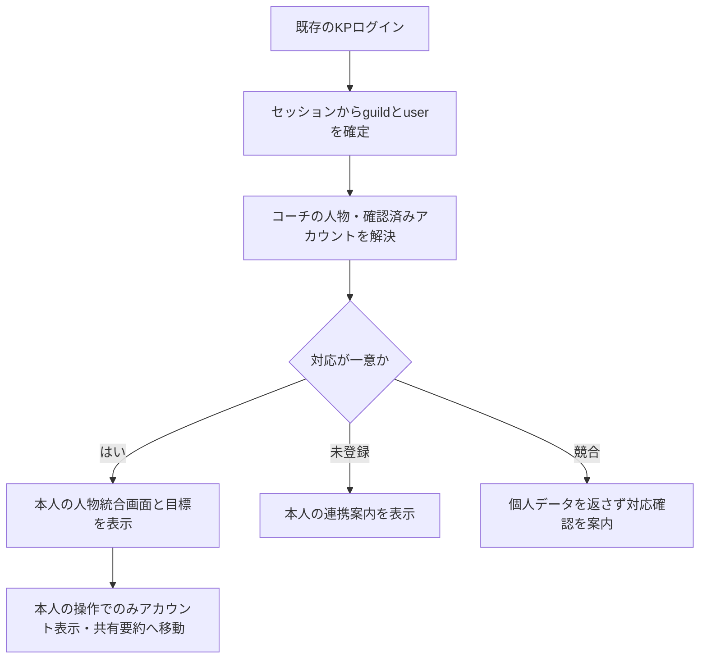

# KESO COACH フェーズ1：本人を起点にした画面・目標・公開範囲

設計日：2026-11-20（JST）  
監査基準：main `e357492b8489df6077f94efa7bfc1ad603330810`  
状態：設計提案。**このPRは設計書だけを追加し、アプリ・認証・DB・本番設定は変更しません。**

フェーズ0（#603・#604・#608・#611）は本番反映済みの前提です。位置保存やバックフィルの設計をやり直さず、次のフェーズで必要になる「誰のためのコーチか」を確定します。包括承認に沿って、以下を推奨設計として具体化しました。実装時の既定動作と分割単位を以下に定めます。

## 1. 採用する方針

1. 開いた直後は、ログインした本人の人物単位の画面を表示します。他人を選んだ記憶やURL指定より本人を優先します。
2. 本人特定は、既存KPセッションのDiscordユーザーと、サーバー側で確認済みのアカウント対応から行います。名前の入力・URL・localStorage・戦績への同席を本人確認に使いません。
3. コーチ専用の人物・複数アカウント対応を分離し、KPの1人1口座という制約や所有者固定トリガーを変更しません。
4. 診断の詳細・目標は本人限定を既定値にします。他のサーバー参加者には、本人が明示的に共有した要約だけを表示します。外部への無認証公開は設けません。
5. 目標は「中期のコンペ目標ランク」と「次の試合で取り組む行動」を各1件登録できます。達成を自己申告と実測で混同しません。
6. 選手一覧・比較・旧API・コピー・キャッシュまで同じ境界を適用します。画面のボタンを隠すだけでは公開範囲の変更と扱いません。
7. 既存のv6デザインと公式画像を維持し、本人表示・目標・共有設定を既存のカードと折りたたみの造形に追加します。

## 2. 既存コードを確認して分かったこと

| 現状 | 根拠となるファイル | フェーズ1での対応 |
| --- | --- | --- |
| KPセッションにはguildとuserがあり、Activity認証も同じセッションに到達します。 | [kp.ts](../services/valorant-results/src/kp.ts)、[discord-activity-auth.ts](../services/valorant-results/src/discord-activity-auth.ts) | ログインを作り直さず、そのuserを唯一の操作主体にします。 |
| コーチAPIは共通の参加者認証後、指定された人物のレポート・5人比較を返します。人物ごとの閲覧許可はありません。 | [kp-api.ts](../services/valorant-results/src/kp-api.ts) の `/coach/member`・`/coach/comparison` | レポート計算前に本人確認と公開範囲の判定を入れます。 |
| 初回loadは `/coach/rounds` を呼び、VDK中心の旧集計を取得します。選手とアカウントのボタンは固定です。 | [coach.html](../coach.html) の `load`・`member-selector` | 初回を `/coach/me` に置き換えます。他人の自動取得をやめます。 |
| 神戸の人物レポートは2アカウントを統合し、アカウント別の表示もあります。 | [coach-member-report.ts](../services/valorant-results/src/coach-member-report.ts) | 人物統合を既定にし、本人だけが自分のアカウント表示へ切り替えられます。 |
| `kp_accounts` は `UNIQUE(guild,user)` で、所有者変更を拒否します。 | [kp.ts](../services/valorant-results/src/kp.ts) のスキーマ・`kp_owner_immutable` | コーチ用の複数アカウント表現をここへ押し込みません。 |
| 練習条件のgoalは画面内の選択状態です。保存された本人の目標ではありません。 | [coach.html](../coach.html) の `defaultPracticePreferences` | 新しい目標登録と区別し、目標の永続化を追加します。 |
| 旧レポート・人物別レポート・比較には、他メンバーを識別できる情報や全体収集状況が含まれます。 | [coach-member-report.ts](../services/valorant-results/src/coach-member-report.ts)、[coach-performance.ts](../services/valorant-results/src/coach-performance.ts)、[coach-round-analysis.ts](../services/valorant-results/src/coach-round-analysis.ts) | 本人向けと共有要約向けのレスポンスを別々の許可リストで構成します。 |
| クライアントの人物キャッシュはtokenを照合しますが、旧集計キャッシュはDB単位です。診断のコピー機能もあります。 | [coach.html](../coach.html)、[coach-round-analysis.ts](../services/valorant-results/src/coach-round-analysis.ts) | 認証変更時の画面消去と、閲覧許可を確認してからキャッシュを返す順序を保証します。 |

関連する未マージPR [#498](https://github.com/altepop/keso-gamble/pull/498) は、VDK既定の私的な`/valo coach`を提案しています。これは現在のmainの実装ではなく、本人既定の画面・目標登録を完成させたものとも扱いません。後で取り込む場合は、非公開のDiscord応答であることだけを認可とせず、本設計と同じ人物単位の所有者照合を適用します。分析ロジックを採用するかの判断と、任意の他人を指定できる権限の判断を分けます。

この監査では秘密の連携設定の中身や本番D1を読み出していません。実装時の本人対応は本番のサーバー管理設定と既存リンクの一致を検証して決めます。

## 3. 本人を特定する流れ

- 人物のキーには表示名やRiot IDを使わず、推測しにくい固定の`subject_id`を使います。Discordユーザーはguild内で1人物、人物には複数PUUIDを対応させます。
- 最初の対応付けは、既存KPのサーバー管理リンク・確認済みPUUID・コーチの人物定義から行います。既存の人物統合に合わせ、神戸の2アカウントを同じ人物へ対応させます。
- 別アカウントは、サーバー側で本人のものと確認済みの対応だけを追加します。本人の入力だけで任意のRiotアカウントを取得・所有できる機能は作りません。
- Riot ID変更時も既に確認したPUUIDを維持します。同じ表示IDが別PUUIDへ移った場合や、別のDiscordユーザーとの競合は自動上書きしません。
- 対応がないKP参加者には「コーチ対象のアカウントがまだ連携されていません」と表示します。VDKや先頭の選手へフォールバックしません。
- 一部の別アカウントが未解決なら、その部分を未確認として表示します。確認済みの本人アカウントまで他人扱いにしたり、他人のデータで補ったりしません。
- コーチ登録・本人設定の作成を理由に、KP口座・所持KP・過去の支給履歴を作り直しません。

## 4. 本人画面と目標の体験

### 開いたとき

「自分のコーチング」→本人の表示名→改善された点→今回の課題、という既存の流れで表示します。自分のレポートを表示するための選手選択は不要です。

神戸は人物統合を既定にし、「自分のアカウントを切り替える」を開いたときだけ各アカウントを選択できます。同じ試合の重複除外は既存のmatch_id基準を維持します。別の人の要約を見た後も「自分に戻る」を常設し、再読込・再ログインでは本人へ戻ります。

未認証時は接続案内だけ、本人未登録時は連携案内だけを表示します。詳細な個人データを先に取得してCSSで隠す処理は行いません。

### 登録できる目標

| 種類 | 登録する内容 | 評価・表示 |
| --- | --- | --- |
| 中期目標 | VALORANTコンペの目標ランク、任意の目標日 | 「目指すランク」として表示します。現在ランクの実測値や、推定実力と混同しません。 |
| 次の試合の行動 | 取り組むこと1つ、最大3つの手順、試合後の確認方法、任意の目標日 | 課題カードの近くに表示し、次の試合で何を確認するか明示します。 |

行動例：「最初の3交戦は、撃った後に戻る遮蔽を決めます」。確認方法は「戻る場所を決めた交戦が何回あったか、自分で振り返ります」。ログで判定できない行動を自動達成と表示しません。

- 各種類の進行中目標は1件です。既存目標があるときは新規作成で増殖させず、編集か終了して次の目標を作ります。
- 目標は未設定でも分析を読めます。入力を強制する初回モーダルは設けません。
- 行動本文は200文字、手順は各80文字・最大3件、確認方法は120文字までのプレーンテキストです。ランクは公式コンペの選択肢から選びます。リクエスト全体はUTF-8で4KiB以下にします。
- 日付は`YYYY-MM-DD`で保存し、表示と日付境界はJSTです。期限を過ぎても勝手に削除・失敗認定しません。
- 進行状態は「取り組み中／本人が達成を記録／終了」とします。「本人が達成を記録」は自己申告だと明示します。
- 本フェーズでは分析の診断条件・閾値・練習候補の選定ロジックを変更しません。本人の目標と既存の提案を併記します。目標達成の実測判定は、必要データを確認して後続フェーズで追加します。
- 入力中の文字は都度DB保存せず、「保存」で確定します。他人の目標は閲覧・編集できません。

## 5. 公開範囲と権限

「公開範囲」の選択肢は**本人のみ／同じサーバーのログイン参加者へ要約を共有**です。未設定・既存利用者とも本人のみとし、過去に他の人へ閲覧できていた事実を共有への同意と見なしません。

| 情報・操作 | 本人 | 同じサーバーの他の参加者 | 未認証・別サーバー |
| --- | --- | --- | --- |
| 個人の詳細診断・試合別分析・自分のアカウント別分析 | 可 | 不可 | 不可 |
| 目標の閲覧・登録・編集・終了 | 可 | 不可 | 不可 |
| 本人の取得状況・欠損の詳細 | 可 | 不可 | 不可 |
| 共有済み要約 | 可 | 本人が共有中の場合だけ可 | 不可 |
| 共有範囲の変更 | 可 | 不可 | 不可 |
| 全体収集の開始・停止などの運用操作 | 別の運用権限がある場合だけ可 | 同左 | 不可 |

- 共有要約の初期許可項目は、本人が設定した表示名、対象期間・試合数、勝率・KD・ACS・ADRと各指標の有効試合数です。未取得値は未取得と表示します。
- 目標、文章による弱点診断、試合ごとの履歴、収集失敗の詳細、Discord ID、Riot ID、PUUID、試合ID、座標、セッショントークンは共有要約へ含めません。目標を共有する機能はフェーズ1に含めません。
- 同一試合の他プレイヤーについて、本人向け分析で必要なチーム集計は匿名の参考値にします。他人の名前・人物別成績・共闘傾向は、本人のレポートに同席していることを理由に開示しません。
- 本人向けも既存の巨大なレポートをそのまま返さず、構造化した許可項目で再構成します。他人の名前を含む旧文章は安全な本文として作り直すか、そのブロックを返しません。文字列の一括置換だけで公開範囲を保証しません。
- 非公開プロフィールは共有一覧から除きます。非公開対象と存在しない対象の指定は同じ404にし、名前や登録の有無を返しません。
- 運用権限は個人情報の閲覧権限とは別です。現行の運用可能者を、無条件に全員の詳細を読める管理者へ拡張しません。全体運用パネルは権限判定後の明示的な表示で、必要な集計件数だけを返します。
- 共有解除はサーバーへ保存できた時点から適用します。次のAPI要求で必ず再判定し、既存の分析キャッシュに共有許可を埋め込みません。既に本人がクリップボードへコピーした内容は回収できないことを設定画面で説明します。

## 6. 保存先とAPI契約

### コーチ専用の3テーブル

| テーブル | 主な項目・制約 | 用途 |
| --- | --- | --- |
| `coach_profiles` | guild、subject_id、owner_user、display_name、visibility、policy_version、updated_at。主キー(guild,subject_id)、UNIQUE(guild,owner_user)。visibility既定private。 | 本人の所有者と共有設定。 |
| `coach_profile_accounts` | guild、subject_id、puuid、account_key、verified_at。主キー(guild,puuid)、人物への複合参照。 | 同じ人物の複数アカウント。PUUIDは外部レスポンスへ出しません。 |
| `coach_goals` | guild、subject_id、goal_id、kind、本文、手順JSON、確認方法、target_rank、target_date、status、version、created_at、updated_at。主キー(guild,subject_id,goal_id)。 | 本人の目標。kind別のactiveな行に部分UNIQUE索引を置きます。 |

共有設定と目標の変更にはversionを用いたCASを使い、競合時は409と更新案内を返します。新規目標はクライアント生成UUIDをgoal_idに使って再送を識別し、同じUUID・同じ内容は重複作成しません。内容が異なる同一UUIDは409にします。

guild・owner_user・subject_idは更新本文から信用せず、セッションと所有者照合から確定します。未知フィールドや他人のgoal_idを使った更新で対象が広がらない契約にします。スキーマ追加は専用のensureスクリプトで行い、過去のmigrationを本番へ一括再適用しません。

### API

既存と同じKP Bearerセッション・Origin制限・`Cache-Control: no-store`を使います。

| API | 契約 |
| --- | --- |
| `GET /api/kp/coach/me` | 本人の対応状況、人物表示、本人用レポート、目標、公開設定、自分のアカウント選択肢。未登録時は案内状態だけを返します。 |
| `POST /api/kp/coach/goals` | 本人の目標を作成・編集・終了。goal_idとexpectedVersionを検証します。 |
| `POST /api/kp/coach/settings` | 本人の表示名と公開設定だけを更新します。所有者・アカウント対応の編集には使えません。 |
| `GET /api/kp/coach/directory` | 同じguildで共有中の人物だけの最小一覧。全員固定一覧は返しません。 |
| `GET /api/kp/coach/summary?subject=…` | 現在の共有許可を確認し、許可リストの要約だけを返します。 |
| 既存 `/api/kp/coach/member?person=…` | 表示名・別名をサーバーの人物対応へ解決して所有者を照合。本人の人物・確認済み別アカウントだけ許可します。他人の共有要約はsummaryから取得します。 |
| 既存 `/api/kp/coach/comparison` | 共有済み要約だけの比較へ変更します。選択はdirectoryから行い、未共有の対象を含む要求は404です。自分を含めても返却形式は要約に揃えます。 |
| 既存 `/api/kp/coach/rounds` | VDK中心の包括レスポンスを廃止し、410と画面更新案内を返します。閉じた旧パネル用だからという理由で存続させません。 |
| 既存 `/api/kp/coach/members/status` | 通常は本人のアカウントの取得状況だけを返します。全体運用集計は運用権限を確認した別の表示に分離します。 |
| 既存のmembers/start・pause・backfill/resume | 現行の明示的な運用権限を維持します。プロフィールの所有者になっただけでは操作できません。 |

`me`のレスポンスには、自分であることと表示範囲を示すメタデータを入れます。例：`identity.status=linked`、`view=self`、`visibility=private`。生の所有者IDはクライアントへ渡す必要がありません。

未認証は401、本人対応の競合は409、未公開または不存在の閲覧対象は404とします。書き込み先としての他人の目標も404にします。入力形式の不正は400です。D1節約モードの429を「他人を読めた／読めない」の判定に代用しません。

## 7. UI・セッション・コピーの境界

- 「分析する選手」の固定一覧は主画面から除き、本人のアカウント切替と「共有された要約を見る」を別の折りたたみにします。比較は公開中の要約だけを明示的に選択して開きます。
- 初回・再接続で`me`を1回呼びます。選手5人分のレポートや旧roundsを先に読み込みません。URLのperson指定は本人判定を変更できません。
- アカウント切替やログアウトを検知したら、描画済みレポート、グラフ、コピー用文字列、textareaのフォールバック、人物キャッシュを先に消去します。
- 非同期要求には認証世代と要求先を紐づけます。古いユーザーの通信が後から終わっても、新しいユーザーの画面へ描画しません。401では復帰用に他人の前の画面を残しません。
- 目標や共有設定はこの端末だけのlocalStorage設定ではなくサーバーへ保存します。端末変更後も本人設定を読み込みます。
- 本人のコピーは明示的な操作だけで行い、既存の識別子除外を維持します。共有要約を見ている間は、裏に残った本人・他人の詳細データをコピーしません。外部公開リンクやトークン入りURLは生成しません。
- 375pxと320pxで、名前、目標本文、長い未登録案内、共有設定、フォームエラーが横にはみ出さず、キーボードでも保存・終了へ移動できることを確認します。

## 8. コスト・互換性・対象外

- Henrikの追加取得はありません。フェーズ0の位置テーブルを通常レポートへJOINしません。KP支給・賭け・精算・Discord通知・収集スケジュールも変更しません。
- 初回本人解決は、所有者のプロフィールとアカウントを取る1クエリ、進行中目標を取る1クエリを基本とします。既存の人物分析読み込みに対する追加は原則2読取クエリです。本人の収集状況取得も他人全員の全体集計を再実行しない構成へ置き換えます。
- 書き込みは保存ボタンで確定したときだけです。ページを開くたびのDDL・自動目標作成・取得状況のポーリング追加はしません。
- 要約比較は明示操作・最大5人物です。既存の分析結果を内部で再利用する場合も、毎回閲覧許可を判定してから要約へ射影します。個人名だけをキーにした共有可能なレスポンスキャッシュは作りません。
- クエリ数とD1 rows_readは別物です。既存のJSONロスター検索はLIMITだけで読み取り費用を保証できないため、実装後に同じ試合数で実行計画と実測rows_readを比較します。節約できたと未計測で報告しません。
- 対象外は、新しい位置分析、診断・練習推薦アルゴリズムの改変、現在ランクの追加API取得、目標の自動達成判定、全世界公開、招待リンク、目標の他人への公開です。

## 9. 実装PRの分割と導入順

### PR1-A：本人解決・既定画面・閲覧境界

人物・アカウント表とサーバー側の対応検証、me、本人用レスポンス、全既存読取経路の権限判定、認証変更時の消去を実装します。v6トップを本人の人物統合表示へ接続します。共有はまだprivateのみで、他人比較は利用不可と明示します。

APIの閲覧制限と新しいトップを同じPRで出し、古いクライアントには410と再読込案内を返します。古い包括APIだけが無制限に残る移行期間は作りません。既存KPの認証方式やセッション自体の一括失効は行いません。

### PR1-B：本人の目標登録

goals表、作成・編集・終了のAPI、version競合、目標カードとフォームを実装します。本人の選んだ目標と既存の分析提案を並べて表示し、診断条件は変えません。

### PR1-C：本人が選ぶ要約共有

公開設定、directory、summary、共有済み要約の比較、共有解除とコピーの境界を実装します。未設定は引き続きprivateです。目標は共有しません。

各実装PRは対応するテストとCI成功を確認してからマージ・デプロイし、認証付きの本人・別人2セッションで本番スモークを行います。実際の別人セッションを用意できない場合は、その確認だけを未実施と明記します。秘密トークンをIssue・PR・ログへ貼りません。ロールバックでも旧来の広い閲覧権限を復活させず、必要ならコーチ画面をメンテナンス表示にします。

## 10. 完了条件とテスト計画

| 分類 | 必須確認 |
| --- | --- |
| 本人特定 | 対象5人・6アカウントのサーバー側対応を確認。神戸は人物統合が既定、アカウント別表示も本人だけ。同一試合を重複計上しません。 |
| 未登録・競合 | 未登録KP参加者、未解決PUUID、所有者競合を扱い、他人へのフォールバックがありません。本人の入力だけでリンクを取得できません。 |
| 既定画面 | 自分の初回表示に選手選択不要。他人表示後の再読込・再接続で本人に戻ります。未認証状態で個人データ要求を行いません。 |
| サーバー認可 | 同じguildの別ユーザー、別guild、別アカウント、別人のgoal_id、URL・本文の所有者偽装を拒否。拒否した要求で分析クエリを実行しません。 |
| 経路の網羅 | me、member、comparison、rounds、status、コピー・比較に必要なAPIを列挙した回帰テストを用意。旧API・非表示パネルからの漏えいを防ぎます。 |
| 目標 | 新規・編集・終了・期限経過、未設定、上限・HTML・不正日付・不正ランク、再送と同時更新を検証。自己申告を自動評価と表示しません。 |
| 共有 | 初期private、共有中だけ要約可、解除後は新しい要求で拒否。目標・個別弱点・他人の名前・識別子・座標が要約へ入らないことを内容で検証します。 |
| セッション・キャッシュ | 同じブラウザで本人A→Bへ切替、古い通信の後着、401、共有解除後のキャッシュ参照、コピー用textareaの消去を検証します。 |
| 表示 | 実データ相当の長い本文を使い375px・320px・PC幅を確認。ChromiumとWebKitで本人表示、編集、共有切替、キーボード操作を検証します。 |
| コスト・回帰 | 追加Henrik要求0、位置読み込み0、本人表示で5人全員を取得しないこと、D1クエリ数・実測rows_readを確認。KP・精算・通知の必要な既存CIも通します。 |
| 本番 | 実装PR番号・SHA・CI・Worker version、本人/別人のアクセス結果、スキーマ検証、D1費用の比較、実施できなかった確認を本文へ記録します。 |

設計PRの作成をフェーズ1機能の実装完了とは扱いません。PR1-A〜Cの導入と本番検証が済んだ時点をフェーズ1の完了とします。
