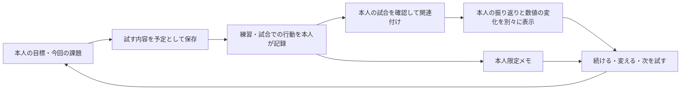

# KESO COACH Phase 2：実装・実施記録、効果検証、個人メモ

設計日：2026-11-20（JST）  
基準main：`dbfdd9dac94eb8858482a03a73ac83190ca4857f`  
状態：設計のみです。このPRはアプリ・API・DB・本番設定を変更しません。機能実装は後続のPR2-A〜Cへ分けます。

依頼の「実装記録」は、開発側の実装状況の記録と、利用者が提案された練習・行動を実際に試した記録に分けます。前者は次節の実装台帳、後者は本人限定の実施記録として扱います。「提案を表示した」「タイマーが終了した」と「実際に練習した」を混同しません。

## 1. 着手前に確認した実装・本番の台帳

| 項目 | 実装・確認状況 | Phase 2での扱い |
| --- | --- | --- |
| 本人解決・人物統合・詳細の閲覧境界 | #613。5人・6アカウント。神戸の2アカウントは1人物です。 | 同じguild/subject/所有者確認を再利用します。 |
| 目標ランク・次の試合の行動 | #614。各1件のactive、UUID再送、version CAS、本人限定です。 | process目標と実施記録を任意に関連付けます。目標本文を重複管理しません。 |
| 選択した要約の共有 | #621。表示名と期間・試合数、選択した勝率/KD/ACS/ADRだけです。 | 実施記録・メモ・反省文・試合の紐付けを共有項目へ追加しません。 |
| 本番ビルド依存 | #623。CI run 44638207938はcheck・両ブラウザ・browser成功です。 | 既存デプロイの依存コピーを維持します。 |
| 原本との完全ハッシュ照合 | #627。main run 44641304061で全CI・deploy成功です。 | 後続PRでもHTMLと新JSの原本照合を行います。 |
| 実施ボタン・タイマー | 現在は画面内だけです。サーバーへの実施保存はありません。 | 保存した予定、本人の実施申告、観測した数値を分けます。 |
| 試合ごとの振り返り | 前の試合との指標差は表示済みですが、practiceVerified=falseです。 | 既存の指標差を練習実施や効果の証拠へ格上げしません。 |
| 個人メモ・永続的な実施履歴 | 未実装です。 | 新設する本人限定データです。 |

着手前の本番監査は2026-11-20 08:59 JSTに完了しました。Worker `7beb542e-3701-4992-9bc8-be28e6faa52e`、所有者5人・6アカウント、全員本人限定、競合・孤児・誤割当・不正ポリシーは0件です。全共有ルートの未認証401・許可外Origin403と、HTML・共有JSの64桁SHA-256原本一致を確認しました。詳細は[#621本文](https://github.com/altepop/keso-gamble/pull/621)に記録しています。

実ユーザー2人の認証済み本番操作はセッション未設定のため未実施です。人工セッションのテストと区別したまま、設計へ進みます。

根拠：[本人対応](../services/valorant-results/src/coach-identity.ts)、[目標](../services/valorant-results/src/coach-goals.ts)、[共有](../services/valorant-results/src/coach-sharing.ts)、[現在の画面内操作](../coach/prototype-view.js)、[試合別フィードバック](../services/valorant-results/src/coach-match-feedback.ts)。

## 2. 利用者の一周を完成させます

- 最初に「前回、実際に試したこと」を表示し、その下に本人の感想と確認できた数値を並べます。
- 「できました／一部試しました／今回は試していません／覚えていません」を区別します。未記録を失敗や0回と扱いません。
- 記録が1件でも、次の試合で確認する行動を提示します。数値が不足するときは、本人が決めた確認方法を使います。
- 「記録から分かること」と「録画や本人への確認が必要なこと」を分けます。本人の申告も、自動検証済みの事実とは呼びません。
- KP付与、罰則、ランキング、練習時間による報酬は追加しません。

## 3. 本人限定で保存する実施記録

### 予定を保存するとき

既存の課題カードから最大3つの練習を選び、1つの実施記録にまとめます。人物ごとの未完了の予定は1件です。保存はボタンを押したときだけです。タイマーの毎秒更新・タブを開く操作・チェックボックスの変更ではDBへ書き込みません。

現在の「この内容で実施します」は、保存後に「今回試す内容を保存しました」と表示します。実施を証明するボタンにはしません。既存v6の配置・造形・公式アートを維持して、状態と保存結果を接続します。

任意で本人のactiveなprocess目標を関連付けます。サーバーで所有者・種類・目標versionを確認し、その時点の行動・手順・確認方法をスナップショットにします。後から目標を編集・終了しても、過去の実施内容は書き換えません。目標の「自己申告で達成」と実施記録の完了は別操作です。

練習ID・カタログversionはサーバーで照合し、現在のカタログ原本から内容を保存します。クライアントから届いた文章だけで「コーチが提案した内容」と認定しません。古いカタログなら409と更新案内を返します。自分で決めた練習は、出所を「本人の選択」として別に記録できます。

### 実施後に保存するとき

本人の実施申告、実際に使った時間（任意）、短い振り返り、次の試合での確認を保存します。タイマーの経過だけで完了にしません。VODや射撃場の状態を自動取得したことにもなりません。

| 入力 | 上限・意味 |
| --- | --- |
| 練習の選択 | 最大3件。登録済みIDまたは本人が入力した練習です。 |
| 実施申告 | done / partial / skipped / unknown。本人の申告です。 |
| 時間 | 任意の整数0〜180分。空欄はnullです。0と未取得を区別します。 |
| 確認回数 | 任意の試行回数と成功回数、各0〜100、成功数は試行数以下です。自己申告です。 |
| 振り返り | 1,000 Unicode文字までのプレーンテキストです。 |
| 実施日 | JSTの日付。保存時刻はサーバー時刻も別に持ちます。後からの登録は明示します。 |
| 要求全体 | UTF-8で8 KiB以下です。スナップショットはサーバーで構成します。 |

自動判定できない行動は、そのまま本人に確認します。例えば「最初の3交戦で退路を決めたか」は申告による振り返りであり、キル時の座標やK/Dだけから成功と判定しません。

## 4. 効果検証は、観察と因果関係を分けます

### 三つの結果を混ぜません

| 結果 | 例 | 表示 |
| --- | --- | --- |
| 本人の実施申告 | 練習した、3回中2回試せた | 「本人の記録」です。ログで実施を証明したとは表示しません。 |
| 試合からの観測 | DPRが0.72から0.63、対象ラウンド数と試合数 | 「記録上の変化」です。分子・分母・除外・期間を併記します。 |
| コーチの次の提案 | 条件をそろえて続ける、内容を一つ変更する | 根拠と未確認事項を示す提案です。練習の効果が証明されたとは表示しません。 |

評価の起点は、予定保存時のサーバー時刻で固定し、後から変更できません。実施日や感想の訂正とは分けます。評価に関係する訂正やデータ補完ではversionと取得時点を更新し、以前の結果を無言で置き換えません。

予定を保存せず過去分だけ登録した記録は「後から登録」とします。実施前の起点がないため、自動の前後比較には使いません。本人の振り返り、関連付けた試合の指標、次回の確認方法は表示します。数値比較をするために、過去の実施時刻を捏造しません。

### 比較する試合

- 起点前10試合と起点後10試合を、終了時刻順の連続した本人の競技試合から選びます。片側の探索期間は起点から30日以内です。良かった試合だけを選ぶ機能は設けません。
- これは「終了時刻を基準にした前後比較」です。保存済みロスターの終了時刻だけで、試合開始が練習後だったと断定しません。
- 「この試合で試した」は本人が明示的に関連付けた場合だけ表示します。関連付けのない試合を、練習を適用した試合として扱いません。
- 神戸の2アカウントは人物単位で重複排除します。同一試合に複数の本人アカウントがある曖昧な行は、既存と同じく除外します。
- 全体の前後比較に加え、同じマップ・エージェントの部分集合を示します。条件別の結果が足りない場合に、別条件の数値で埋めません。
- 試合数、攻守・ロール・相手・味方構成・ACT・同時に変えた練習などの違いを残します。本人の成績差を練習だけの因果効果と呼びません。

### 指標と計算

主指標は実施記録ごとに1つ、補助は最大2つを選びます。候補は既存のK/D・KPR・DPR・ACS・ADR・HS%です。勝率は参考の文脈に限定し、個人の練習の成功判定には使いません。FK/FDだけで評価を作りません。

| 指標 | 再利用する定義 |
| --- | --- |
| K/D | 有効な試合の合計K÷合計D。試合ごとの比率の単純平均にはしません。 |
| KPR / DPR | 有効なキル数またはデス数÷有効ラウンド数です。 |
| ACS | 有効なスコア合計÷検証済みラウンド数です。 |
| ADR | 有効な与ダメージ合計÷対応するラウンド数です。 |
| HS% | 命中部位データの頭命中数÷全命中数×100です。ヘッドショットキル率にはしません。 |

[既存coachPerformance](../services/valorant-results/src/coach-performance.ts)と同じ有効性判定を使います。指標ごとに有効試合数、分子・分母、除外数・理由、期間、取得元、取得時点、評価ルールversionを返します。欠損はnullです。後からデータが補完された場合は、同じ時点のデータで前後を再計算し、更新したことを明示します。

両側が1試合でも数値は件数付きで読めますが、改善・悪化の結論は出しません。片側5試合未満は「観察中」、両側5試合以上は「暫定の傾向」とします。この5試合は表示上の運用基準で、統計的有意差・実力認定・効果証明の閾値ではありません。10試合ずつそろっても因果関係は断定しません。

成績が下がった場合も、実施できた行動、相手や条件の違い、次に確認する一場面を返します。「データ不足」だけで止めたり、本人の未実施を推測して叱責したりしません。

## 5. 試合の関連付けと個人メモ

### 試合の関連付け

サーバーが本人の確認済みPUUIDで候補を取得し、日付・マップ・エージェント・勝敗を返します。選択用matchRefはguild・subject・match_idをドメイン分離してSHA-256化した不透明参照にします。参照自体を認可には使いません。保存時に現在の所有者と候補ロスターを再確認し、他人・別guildの試合は404です。生のmatch_idやPUUIDを新しい画面・コピーへ追加しません。

候補は1回20件までです。関連付けは実施記録1件につき1試合です。複数試合で試した場合は次の実施記録として残し、後述の前後比較は関連付けた良い試合だけに限定しません。APIにない試合を新たにHenrikから取得する処理は追加しません。

### 個人メモ

題名80文字・本文2,000 Unicode文字までのプレーンテキストです。人物全体、実施記録、本人の試合のいずれかに任意で関連付けられます。本文のMarkdown/HTML実行、添付・VODアップロード、外部LLMへの送信、自動での人格・身体タイプ推定は行いません。

手動保存にし、入力のたびにDBへ書き込みません。通信失敗時は同じ認証の画面内だけに入力を残します。未保存の通常画面移動では保存・破棄・戻るを選べます。ログアウトや認証切替では、別ユーザーへ入力を残さず消去します。端末の永続ストレージへ下書きを保存しません。

本人の明示操作で削除できます。本文と自由記述のスナップショットを消し、再送による復活を防ぐ最小の削除済みUUID・versionを残します。バックアップからの消去期限は既存D1の運用に従い、即時に全バックアップが消えるとは約束しません。

## 6. 保存先とAPIの境界

新設するのは次の2テーブルです。集計結果を全試合・全記録へ自動保存するテーブルは作りません。

| テーブル | 主な列・制約 |
| --- | --- |
| coach_practice_records | guild, subject_id, record_id, goal_id, goal_version, goal_snapshot_json, catalog_version, plan_json, execution_json, reflection, match_id（内部のみ）, planned_at, occurred_date_jst, recorded_at, status, version, create_hash, updated_at, deleted_at。主キーは(guild,subject_id,record_id)、人物への複合参照、未完了予定は人物ごとに1件です。 |
| coach_personal_notes | guild, subject_id, note_id, title, body, record_id, match_id（内部のみ）, version, create_hash, created_at, updated_at, deleted_at。主キーは(guild,subject_id,note_id)、人物への複合参照です。 |

実施記録の状態はplanned / recorded / skipped / deletedです。予定・カタログ・目標の原本スナップショットは作成時に固定し、実施申告・メモの修正はversionで競合検出します。削除後の同一UUID再送は削除状態を返し、内容を復活させません。親参照は必ず同じguild/subjectへ限定し、goal_id・record_id・matchRefを使った所有者のすり替えを拒否します。

| API案（/api/kp/coach/配下） | 用途 |
| --- | --- |
| GET practice/records?cursor=… | 本人の実施履歴を20件ずつ返します。 |
| POST practice/records | UUIDとexpectedVersionで予定・実施申告・修正・削除を保存します。 |
| GET practice/matches?record=…&cursor=… | 本人の試合候補だけを20件まで返します。 |
| POST practice/match | record_id・matchRefを検証して関連付けます。 |
| GET practice/review?record=… | 1件の記録に対する観察結果を読取専用で返します。 |
| GET notes?cursor=… | 本人のメモを20件ずつ返します。 |
| POST notes | UUIDとexpectedVersionで作成・修正・削除します。 |

guild・subject・ownerは既存セッションとresolveCoachIdentityから確定します。本文・URL・localStorageの所有者指定を信用しません。未認証401、許可外Origin403、他人や不存在404、CAS409、入力不正400、本文過大413です。全レスポンスをno-storeにします。

private read/writeの認証世代チェックをPhase 1から継承し、古い通信の後着、401、本人・別人への切替で履歴・メモ・コピー用テキストを消去します。共有要約へ移る際も同じ消去を行います。共有用directory/summary/comparisonの許可リストには、Phase 2の項目を追加しません。

本人の記録・メモのコピーは別の明示操作にし、メモを含める選択は初期OFFです。共有要約のコピーと経路・形式・状態を分離します。

## 7. コストと運用

- KP、賭け、精算、既存通知、Henrikの収集・オプトイン、位置保存・バックフィルを変更しません。位置データによる行動判定も追加しません。
- meへ履歴・メモ全文・全評価を同梱しません。小さな自分の最新状態だけを最大1読取で追加し、一覧・評価は明示操作で読みます。起動時に5人全員を読みません。
- 実施履歴とメモは(guild,subject_id,updated_at DESC,id)の索引と不透明カーソルで20件ずつ取得します。OFFSETで履歴全体を走査しません。削除済みは通常一覧から除外します。
- 1評価要求は1記録・前後各10試合です。時間範囲と既存終了時刻索引を使い、全記録×全試合の再計算を行いません。JSON内の本人照合ではLIMITをrows_read上限とみなしません。
- 指標の計算・有効性判定を再利用し、1要求内で同じロスターを何度も問い合わせません。試合候補の参照検証にも取得済みの集合を使います。
- 節約モードは認可後に重い評価取得だけを429にします。記録・メモの保存と小さな履歴は維持します。自動ポーリング・毎秒保存は追加しません。
- 専用ensureで必要な追加スキーマだけを適用します。本番へ人工の実施・メモ・共有設定を投入しません。
- 追加クエリ数とrows_readを分けて計測します。同じロスター件数で既存レポートと新評価を比較し、実行計画・読取件数・CPU時間をPRへ記録します。未計測を改善実績と報告しません。

## 8. 実装PRの分割と完了条件

### PR2-A：本人の実施記録と個人メモ

専用テーブル、owner/CAS/UUID再送、予定・自己申告・メモの登録編集削除、未保存入力の扱い、v6画面への接続を実装します。カタログ・目標versionの整合と削除後再送を検証します。この段階で効果検証済みとは報告しません。

### PR2-B：本人の試合との関連付け・観察による効果確認

matchRefの本人照合、連続した前後比較、指標別欠損・分母・条件差、後登録の区別、補完による再評価を実装します。K/D以外のラウンド効率や本人の確認も使い、因果的な効果証明とは表示しません。

### PR2-C：振り返りから次の試合へ戻る画面

「前回試したこと→本人の確認→数値の変化→続ける／変更する→次の試合で確認」をv6トップへ接続します。提案を表示するだけの状態へ戻さず、本人の記録と次の一手を見せます。320px・375px・PC幅、本文16px、敬体、公式画像を維持します。

各PRでCI全成功後にマージし、デプロイとスモークを確認します。人工データでのテスト、本番の無認証境界・集計監査、実ユーザー確認は区別して記録します。

| 分類 | 必須検証 |
| --- | --- |
| 所有者・公開範囲 | 本人A/B、別guild、所有者偽装、他人のrecord/goal/matchRef、未登録・競合、運用権限からの昇格禁止、公開要約への混入禁止。 |
| 保存 | 再送・並行保存・CAS・古いカタログ・閉じた目標・訂正・削除後再送・上限・Unicode・HTML文字列・日付・0とnull。 |
| 評価 | 比率を単純平均しないこと、指標別の欠損、前後窓の連続性、重複・神戸2アカウント・除外、同条件比較、後登録、時刻が分からない事項を推測しないこと。 |
| UI・セッション | キーボード、未保存移動、保存失敗、401、別人切替、古い通信、共有画面移行、コピーと下書きの消去、320/375px・Chromium/WebKit。 |
| 運用・性能 | 保存時だけの書込み、ページング索引、ポーリング0、追加Henrik要求0、位置読込0、既存KP/精算/通知回帰、同件数のD1実測。 |
| 本番 | PR・SHA・全CI・Worker version・スキーマ・所有者集計・全新規ルートの401/403・HTML/新JSの原本完全ハッシュ・認証済み操作の実施/未実施。 |

Phase 2全体の完了は、PR2-A〜Cの機能と検証がそろった時点です。設計PRの作成、コード追加、ビルド成功だけを実装完了とは扱いません。実ユーザー確認を行えない場合は未実施と明記し、承認済みの運用上の扱いと区別します。
