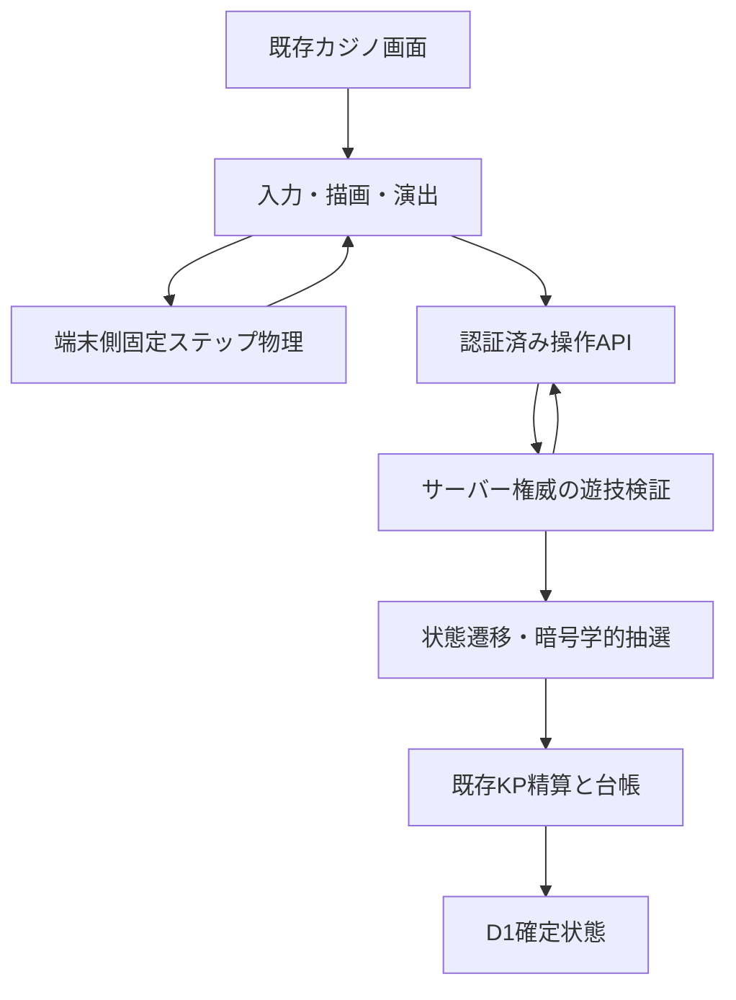

# KESO CASINO パチンコ開発マスター計画

- 起案日: 2026-11-28 JST
- 状態: 設計案・未実装（この文書の存在は機能完成を意味しない）
- 対象: altepop/keso-gamble の既存カジノ第8種目
- 管理: 本書を唯一の全体ロードマップとし、個別PRは要件ID・検証証跡を紐付ける。
- 関連: [演出仕様](PACHINKO_EFFECTS_SPEC.md) / [実装・検証台帳](PACHINKO_DELIVERY_TRACKER.md)
- 参照: [現行ガイド](ACTIVITY_TUTORIAL.md)、[既存追加カジノ仕様](CASINO_MORE.md)、[README](../README.md)、[KP基盤](../services/valorant-results/src/kp.ts)、[テスト構成](../package.json)。

## 1. 目的と範囲

既存のカジノに、操作可能なハンドル、玉と釘の物理挙動、保留、液晶図柄、可動役物、遊技状態、記録を備えたオリジナルのパチンコを追加する。初号機1台を完成させた後、同じ形式の機種定義・アセットで増設可能にする。映像品質は実機のような立体的な筐体と短編映像の一体感を目指し、既存作品の名称・ロゴ・映像・音源・キャラクターは無断利用しない。KPは換金・現実の商品交換・購入不可のゲーム内ポイントに限定する。現金や有償通貨と接続しない。演出は明瞭な結果表示と観賞品質を目的とし、依存を促す誘導、実際より高い勝率の示唆、損失の取り返しを促す設計、偽のニアミス・個人別の隠れた確率変更は禁止する。

対象外: 他カジノの全面改修、メダルゲーム本体、複数機種同時開発、3Dホール歩行、現金機能、追加課金、無断の本番KP/D1操作。共通化は必要最小限にし、将来拡張を理由とした大規模な先行リファクタリングをしない。

## 2. 要件と完成の定義

| ID | 要件 | 完成証拠 |
|---|---|---|
| PK-R01 | 既存カジノ内の機種選択と遊び方 | 既存7種を壊さないPC・モバイルE2E |
| PK-R02 | 機種定義・盤面・演出定義を分離、バージョン固定 | schema検証・旧セッション復元 |
| PK-R03 | ハンドル、停止、玉の物理挙動 | 軌道・衝突・FPS計測 |
| PK-R04 | 釘、風車、レール、始動口、一般入賞口、アタッカー | 盤面試験と入賞集計 |
| PK-R05 | 保留、通常、時短/ST、RUSH、ラウンド、残保留 | 状態遷移網羅テスト |
| PK-R06 | 3D筐体、液晶、照明、可動役物 | 実機動画・スクリーンショット、軽量モード |
| PK-R07 | オリジナル演出の同期・スキップ・縮小 | 演出単体テスト・アクセシビリティ |
| PK-R08 | デモと本番の完全分離 | デモ操作で本番通信・残高変化ゼロ |
| PK-R09 | サーバー権威の抽選・入賞判定・精算 | 改ざん拒否、再送、並行操作、台帳一致 |
| PK-R10 | 中断・復旧・機種更新・停止 | 障害注入、復旧訓練 |
| PK-R11 | 公開スペック、収支、遊技時間、履歴 | 理論・実測検証、UI表示 |
| PK-R12 | D1・CPU・CIの軽量性 | 隔離実測、既存基準との差分 |
| PK-R13 | 責任ある遊技、予算・休憩・終了 | 自動追加貸出なし、任意停止、確率・純損益表示 |
| PK-R14 | 本番配備と証跡 | 全CI、同一main SHAのPages/Worker、スモーク |
| PK-R15 | 素材の出所・権利 | アセット台帳、ライセンス・同意の確認 |

## 3. データ辞書（設計案）

単位・座標系・丸め・最大値・NULL可否・バージョン・移行方法を実装前にschemaへ記録する。未確定の値は設定ファイル上で仮値と明示する。

| データ群 | 項目 |
|---|---|
| 機種 | machineId, displayName, machineVersion, schemaVersion, physicsVersion, effectsVersion, assetManifestHash, availability, supportedModes |
| 抽選 | normalProbability, highProbability, transitionTable, rushEntryProbability, rushEndCondition, timeShortSpins, stSpins, jackpotTypeWeights, holdLimitNormal, holdLimitRight, holdPriority, holdCarryPolicy, drawPolicy, timingTable, roundCount, roundTimeLimit, roundEntryLimit |
| 賞球・経済 | payoutByPocket, payoutByJackpotType, ballsPerLoan, loanKP, exchangeRatioNumerator/Denominator, integerRounding, loanLimit, sessionLossLimit, sessionTimeLimit, sessionPayoutLimit, refundPolicy, returnRateVersion |
| 盤面 | boardWidth/Height, coordinateSystem, scale, bounds, launchRail, left/rightRoute, pins[id,x,y,radius,angle,material], windmills[axis,shape,inertia,drag], rails[points,thickness], pockets[id,shape,type,payout,enabledState], gates[geometry,openWindow], outPocket, collisionLayers, sensorPriority |
| 玉 | radius, mass, density, restitution, friction, gravity, damping, launchPosition, speedRange, angleRange, inputQuantization, spin, maxLifetime, maxActiveBalls, fixedStep, maxSubsteps, CCD, stuckPolicy |
| 筐体 | modelRef, meshGroups, materials, textureRefs, lightZones, pivots, glass, cameraPresets, rigRefs, handleRange, buttonHitboxes, lodLevels, fallback2D |
| 演出 | effectId, version, allowedResultClasses, duration, tracks, keyframes, assetRefs, reducedMotionVariant, silentVariant, skipTarget, cleanup, accessibilityLabel |
| 素材 | assetId, path, hash, format, resolution, duration, sizeBytes, source, license, author, consentStatus, attribution, fallback |
| セッション | guild/user（サーバーで認証から導出）, sessionId, machineVersion, mode, lifecycle, ballsBalance, loanedBalls, launchedBalls, returnedBalls, awardedBalls, stateVersion, lastSeq, lastConfirmedTick, holds, roundsRemaining, roundEntries, stRemaining, timeShortRemaining, pendingResult, startedAt, updatedAt, settledAt, expiryPolicy |
| 乱数・検証 | algorithmVersion, commitment, privateSeed（サーバーのみ）, drawCounter, launchCounter, canonicalInputDigest, trajectoryVersion, receipt, finalReveal, auditVersion |
| 精算 | operationId, requestHash, sessionId, pre/postStateVersion, deltaKP, deltaBalls, ledgerRef, resultId, createdAt, resultStatus |
| 統計 | sessionCount, playSeconds, totalSpins, normalSpins, rushSpins, firstJackpots, jackpots, rushEntries, maxStreak, shots, pocketCounts, totalPayoutBalls, netBalls, totalLoanKP, netKP, timeSeriesBuckets |
| 運用 | featureFlag, maintenanceMode, configVersion, errorCode, performanceCounters, auditEvent, releaseSHA, rollbackVersion |

### 3.1 スペックの確定手順

以前の案（通常1/99、突入50%、高確率1/45、ST70回）は設計議論の仮値で、承認済みではない。賞球、交換、上限、残保留、貸出単位、RUSH中の玉消費が未確定のため還元率は未算出。まず数学モデルと大量試行を用意し、公開条件に一致すること、収支の分布、KP総供給への影響を確認してから決める。勝率をユーザー別・時間帯別に秘匿変更しない。結果を見て演出や抽選条件を差し替えない。新しい設定は新バージョンとして公開し、稼働中セッションには遡及適用しない。

### 3.2 保存ポリシー

固定機種・盤面・演出・素材は原則リポジトリの静的データで配信。現在状態、操作の確定証跡、KP台帳をサーバー管理する。全フレーム・全衝突のD1保存はしない。集計は確定操作の差分で更新し、全履歴スキャンを避ける。過去のKP台帳・冪等性記録は既存方針に従い保持する。秘密シード、Discord識別子、個別残高、秘密設定を公開リポジトリや共有フィードへ出さない。

## 4. システム構成

ブラウザー: 2D物理 + 3D描画を初号機の第一候補とし、WebGL不可時はCanvas 2Dを検討。Three.js、Rapier 2D、Web Worker、GLB/glTF、既存esbuildは採用候補に留め、バンドルサイズ・CSP・Discord環境・ライセンス・CPU実測後に選定。固定タイムステップ・描画補間・入力の量子化・シードの分離・バージョン固定を行う。玉の衝突や描画はD1にアクセスしない。

サーバー: Workerが確定抽選、認証、状態、精算を担当。既存のkp_wallets、kp_ledger、kp_operations、kp_stateおよび操作ID/リクエストハッシュによる再送対策とバージョン競合防止を利用可能か確認する。既存台帳の原子性を維持する。DB構成は専用セッション表と既存状態への格納を比較して決める。新規有料サービス・定期cronは原則不要。

### 4.1 物理入賞の信頼境界

候補A: 端末申告のみ（不採用）。
候補B: サーバーが公開された入賞モデルに従って確定し、端末描画は表示のみ。物理操作の影響範囲を正直に表示する。
候補C: 固定入力・バージョン固定によるサーバー側再演算、または事前検証済み軌道によるサーバー検証。端末・Workerの決定論・負荷をPoCで確認する。

Cを第一検討、失敗した場合はBの透明な仕様に縮小する。クライアントの入賞、賞球、当たり、残高申告を信用しない。決定論的ライブラリという理由だけでクロス環境一致を主張しない。PoCで同一入力の一致、入力改ざん、シードの秘匿、CPU上限を確認。事前軌道方式の場合、見た目が示す操作効果と実際の結果モデルが一致することを確認する。

### 4.2 状態遷移

通常、保留、図柄変動、リーチ、大当たり、ラウンド消化、RUSH/ST、時短、右打ち、残保留、玉切れ、中断、通信切断、精算待ち、終了、メンテナンスを定義する。遊技状態と演出状態は別管理。抽選は確定順序を保存し、演出スキップ・再読込・切断・再試行で再抽選させない。中断時は発射を止め、確定済み結果の再現・残玉の安全な交換を可能にする。通信不明時は未確定操作を繰り返し発行せず既存操作IDで照会する。休憩・時間/予算上限・停止は結果確認と精算を妨げない。

### 4.3 API・DB案

- machines: 公開スペックとバージョン
- start/loan: セッション開始と明示的な玉貸し
- state/resume: 確定状態の復元
- play: 有界な操作バッチの検証、結果・状態差分
- settle: 残玉交換と終了（冪等）
- history/stats: カーソル付き・上限付き履歴
- verify: 終了済みの公開可能な検証情報

認可、セッション所有、入力範囲、シーケンス、状態version、操作ID、request hash、レート制限を検証。内部エラーや秘密値は返さない。DB候補: pachinko_sessions（guild,user,session）、pachinko_results（session,seq）、pachinko_daily_stats（guild,user,day）、pachinko_machine_stats（guild,machine,day）。必要なインデックスとクエリ計画を実測で確認する。二重精算、別人操作、旧version、複数タブの競合を拒否する。精算は既存操作基盤と同じ原子性を持つことが条件。

## 5. 画面と機能

カジノ内の入口 → 機種選択（公開スペック・遊び方） → デモ/本番選択 → 筐体 → 結果・履歴 → 終了。常に持ち玉、確定収支、貸出額、残り時間/上限、停止/精算への導線を確認できる。スマホ縦画面は操作対象を優先、PCは筐体とデータカウンターの2列。通信中の確定/未確定を区別。音声初期無効、減光・動きを減らす・スキップに対応。自動追加貸出、損失追跡の誘導、プレイ再開を迫る通知は採用しない。

データカウンター: 総回転、通常/高確率回転、初当たり、大当たり、RUSH突入、最大継続、累計発射/獲得玉、実測入賞率、差玉、KP純損益、遊技時間、履歴。統計は過去結果で次回の独立抽選確率が変わらないことを明示する。

## 6. パフォーマンス予算（全て未実測）

- 端末: スマホ30FPS以上、PC60FPSを検証目標。FPSだけでなくp95フレーム時間、長時間のメモリ、温度・バッテリー、画面復帰時の負荷を記録する。
- 物理: 初期同時玉数はPoCで決定。固定ステップ、上限、休止・破棄・画面非表示時停止、WebGL context lost復旧。
- D1: 描画・フレーム・衝突・素材ロードの照会ゼロ、新規Cron原則ゼロ。パチンコ増分は想定負荷下で日5万rows_read以内を暫定予算とする。既存全体100万行/日目標を超過させない。rows_written、CPU、リクエスト件数も記録する。
- D1計測: 隔離環境でセッション開始、操作、精算、再送、履歴、10人並行の同一fixtureを実行し、rows_read/written、EXPLAIN、p50/p95を報告。利用量の仮定と計算根拠も記載。
- CI: 既存2分目標を意識。変更前後を同条件で比較し、必要な検証の省略・緩和で達成したことにしない。
- 静的素材: 遅延読込、圧縮、LOD、キャッシュ、失敗時の代替。大容量素材は権利と配信コストを確認する。音声はオプトイン。
- 無料枠内で成立しない構成は本番有効化せず、代替方式・縮小案を示す。

## 7. 開発ツール・ファイル案

開発者用盤面エディター、機種schemaバリデーター、物理デバッガー、軌道再現、入賞率シミュレーター、抽選・経済シミュレーター、演出プレビュー、状態遷移試験、FPS/メモリ/CPU計測、D1負荷測定、アセットライセンス検査。開発・デモ用結果注入は本番ビルド/APIから隔離する。

想定ファイルは新規案。既存構造調査後に確定する。
- js/pachinko/: engine, lottery, state-machine, physics, physics-worker, renderer, cabinet, effects, controls, api, stats, view
- js/arcade-core/: 必要な場合のみ physics-adapter, render-loop, performance
- assets/pachinko/: machines, models, textures, effects, audio, manifest
- css/pachinko.css
- services/valorant-results/src/: pachinko, pachinko-session, pachinko-verifier, pachinko-settlement
- tools/pachinko-editor/; tests/pachinko-*.test.js; scripts/pachinko-*-check/benchmark/simulation
- docs/: 本書、演出仕様、検証台帳、必要に応じた個別設計書

## 8. 開発・配備ルール

詳細フェーズは[実装・検証台帳](PACHINKO_DELIVERY_TRACKER.md)を参照。1PR=1独立分割、Draft、実装/テスト、最新mainとの競合なし、全必須CI成功、head SHA固定のマージ、同一main SHAのPagesとWorker配備、スモーク、PR本文への証跡記録。保護ルールに従い強制マージしない。資料のみのPRでもリポジトリの必須ゲートを尊重する。許可なく本番D1/KP書込、報酬、追加課金、破壊的変更をしない。実装済・配備済・機能有効・実機確認は区別する。未確認の項目は未確認と記録する。リリースは既定OFFの機能フラグ、ロールバック/新規開始停止、既存セッションの精算を先に検証してから行う。

## 9. 未決事項（承認/実測待ち）

機種名、世界観、正式スペック、賞球と交換比率、予算/時間上限、最大持ち玉、採用ライブラリ、物理検証方式、DB方式、対応端末・アセット予算、音声の実機共存、公開時期。これらを勝手に本番確定しない。素材調達は出所とライセンスを記録し、第三者の肖像・音声・名前は同意が確認できる場合のみ採用する。

完成の主張はPK-R01〜15の証跡をすべて確認した時点のみ可能。Phase 01から開始し、まず既存カジノ境界と負荷基準、物理検証方式のPoC条件を確定する。
