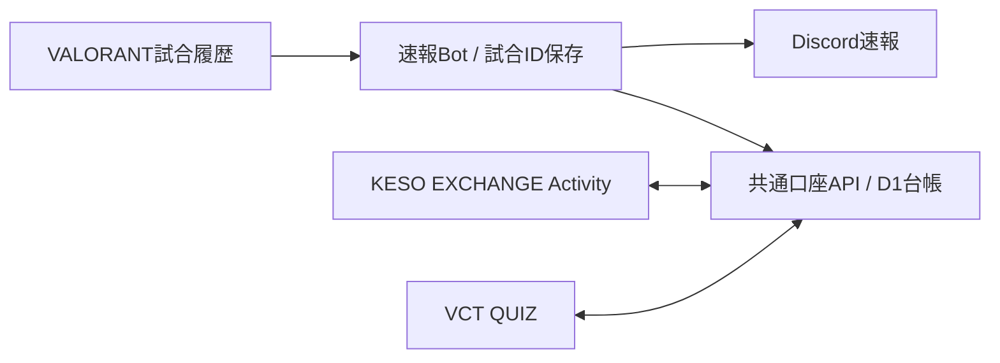

> 更新（2026-10-27）: 下記は移管時の仕様です。現在はKPの自動支給・署名済みDiscordコマンドによる口座接続・サーバー決済を追加しています。現行仕様は [試合KPの運用](../../docs/POINT_REWARDS_PLAN.md)。旧reward_*基盤は保持し、新kp_*を追加。通話・Steam・デスマッチ・カスタムの支給は保留です。

> 公開移管版: 文中の人物・ID・稼働先はサンプルです。実設定と原文の決定記録は非公開で引き継いでいます。npm ciでサンプルのローカル設定を生成します。実設定を上書きしません。

# VALORANT速報・VCT QUIZ・KESO EXCHANGE 統合案

更新: 2026-10-26 JST。これは実コードを確認して作成した接続仕様と段階的な実装案です。共通口座・Activity認証・自動支給はまだ本番実装されていません。

## ユーザーが決めたこと

- 同じDiscordアプリでVCT QUIZログイン、/death、/valo、Activityを共存させる。
- VALORANTの試合履歴を確認して、Activityで使う元手を得られるようにする。
- 報酬は「モード別の参加報酬＋勝利ボーナス」。具体的なポイントは未定。
- デスアンレのボトム条件はACS最下位。Performance Scoreへの置き換えは行わない。
- 相手のPCにソフトを入れたり操作したりする方式は採らない。

以下の配置先・対象モード・初回の遡及範囲は提案です。通貨名は現在のActivityに合わせてKCを仮置きし、別タスクで使われているKPとの呼び名は実装時に統一します。

## 確認できた現在の実装

| 部分 | 確認したもの | 状態 |
| --- | --- | --- |
| 速報Bot | この作業フォルダのsrc/index.ts、migrations | Cloudflare WorkerがHenrik APIを毎分確認し、D1に試合ID・勝敗・モードを保存、Discord Webhookで投稿 |
| Discord操作 | src/discord-interactions.ts、discord-config.json | 共通アプリの署名を検証し、/deathと/valoを処理 |
| クイズ | altepop/valo-quiz/main/server/src/accounts/discord.ts | Discord OAuth identifyでDiscordユーザーIDを取得。クイズ側のログイン・DBは独立 |
| クイズ通知 | altepop/valo-quiz/main/docs/DISCORD_RANKED_QUEUE.md | ランク待機列をBot RESTで通知。VALORANT履歴の受信・共通通貨口座ではない |
| Activity | altepop/keso-gamble/main/README.md、index.html | 単一HTML。残高・株式・ルーレット・給与はlocalStorageのデモ。共通口座・認証バックエンド・Bot付与は未実装 |

KESO EXCHANGEのREADMEではKCは現実の金銭・商品に交換できないゲーム内通貨と定義されています。今回もその範囲で設計します。

別タスク「構造を精査して全面改善」が通知文からの連携を検討していたことも確認済みです。速報Botはこのローカルフォルダにあり、GitHubにあるクイズ・Activityのコードだけでは試合ID保存処理を追えない状況でした。この仕様・ソースのGitHub共有や、別タスクへのメッセージ送信はまだ行っていません。

## 推奨する共通化の中心

DiscordユーザーIDで識別する、サーバー管理のKC口座をCloudflare Worker＋D1に追加します。既存の毎分監視と同じ基盤を利用でき、クイズサイトの起動待ちが試合報酬を止めない構成です。Activity画面はkeso-gamble、クイズ画面はvalo-quizに保持します。

速報の投稿と口座への支給は独立して扱います。Discordへの送信失敗で報酬を失わず、口座処理の失敗で速報を止めないよう、それぞれ保存済み状態から再試行できる設計にします。

## 身元のひも付け

共通のキーは「DiscordユーザーID」です。名前・表示名・Webhookの投稿者名ではひも付けません。

初期対応表を`reward-accounts.json`に保存済みです。Discord IDは精度を失わないよう文字列として保持します。

| 名前 | Riot ID | DiscordユーザーID |
| --- | --- | --- |
| プレイヤーA | PlayerA#TEST | 100000000000000001 |
| プレイヤーB | PlayerB#TEST | 100000000000000002 |
| プレイヤーC | PlayerC#TEST | 100000000000000003 |
| プレイヤーD | PlayerD#TEST | 100000000000000004 |

内部の同期処理は保存済みの監視アカウントからPUUIDを解決します。未取得の人は保留します。同期を繰り返しても初回登録時刻や残高をリセットしません。現時点では監視から同期処理を呼んでおらず、本番の対応表は未登録です。

- Riot側は名前変更に強いPUUIDで管理します。Riot IDは表示・初期解決用です。
- 初期の4人は管理者が同意済みのRiotアカウントとDiscordユーザーIDを対応付けます。DiscordログインだけでRiotアカウントの所有が証明できるとは扱いません。
- 同じサーバーの同じPUUIDを複数の口座に登録しません。解除・再登録で同じ試合の報酬を取り直すことも禁止します。
- ActivityはEmbedded App SDKのauthorizeから得たコードをバックエンドで交換し、サーバーがDiscordの本人情報を検証して口座を特定します。ブラウザーから渡されたuserIdだけでは残高を返しません。
- クイズの既存ログインCookieがActivityでもそのまま使えるとは仮定しません。それぞれの認証結果を、同じDiscordユーザーIDへ対応付けます。

[Discord公式Activity認証手順](https://docs.discord.com/developers/activities/building-an-activity#step-5-authorizing-authenticating-users)

## 試合データの共通契約

`src/reward-contract.ts`に型・生成・検証・報酬見積もりを用意しました。現在の監視処理にはまだ接続していません。外部へデータを送る処理はありません。残高更新は別の内部モジュールに用意し、まだ監視処理から呼び出していません。

- イベント名: valorant.match.completed、schemaVersion: 1
- subject: PUUID。受取人のDiscordユーザーIDはサーバー保存の対応表から決定する。
- match: 試合ID、competitive/escalation/unratedのモード、win/loss/draw、開始・終了時刻。
- observedAt: Botがデータを取得した時刻。
- eventId: guildId＋試合ID＋PUUIDから生成する安定したキー。モード名の別表記や再取得時刻、名前変更、報酬設定の変更でキーを変えない。
- 元データは完了済み試合のみ。未完了・対象外モード・監視開始以前・本人不在・不整合のデータはイベント化しない。
- スキーマ検証だけで送信元の信頼性は証明できません。Activity画面から完成イベントを提出させて支給するAPIにはしません。

同じWorker内の監視処理から共通口座へは内部処理として渡します。後から別サービスへ分ける場合は、受信先限定のサービス認証・本文署名・時刻・再送の扱いを実装します。Webhookのチャット本文を支給根拠として解析する必要はありません。

## 報酬設定

`rewards-config.json`は現在enabled=false、全金額null、startsAt=nullです。startsAtは支給対象の開始日時をUnixミリ秒で指定する設定で、未設定では支給できません。金額が未設定のモードは、付与済み・0ポイント支給済みとして処理せず未設定のままにします。報酬見積もりは残高更新ではありません。

| モード | 参加報酬 | 勝利ボーナス |
| --- | --- | --- |
| コンペ | 未定 | 未定 |
| エスカレーション | 未定 | 未定 |
| アンレ（対象に含める場合） | 未定 | 未定 |

勝ちは参加報酬＋そのモードの勝利ボーナス、負け・引き分けは参加報酬のみです。テスト内の100・50などは検証用の数字で、実運用の金額ではありません。

初回の自動付与は、ひも付け・報酬開始日時以降の新しい記録から始める案です。過去履歴の一括支給は別途決めます。既存の古い試合へ自動で遡って支給する実装は加えていません。

通常のアンレは現在の通知・保存対象から外れています。アンレも報酬対象にする場合は、報酬用の試合収集を/death予約判定と分けます。普通のアンレをすべてデスアンレとして通知する変更はしません。

## 台帳と二重支給防止

`migrations/0005_reward_wallets.sql`に以下の口座・対応表・台帳を追加しました。本番DBには未適用です。`src/reward-accounts.ts`と`src/wallet.ts`は内部用の処理で、HTTPから呼べるAPIではありません。

1. reward_accounts: guildId、PUUID、DiscordユーザーID、登録時刻、有効状態。対応表を内部処理で同期する。PUUIDの所有者を自動で別ユーザーへ移す更新は拒否する。
2. reward_wallets: guildId＋DiscordユーザーIDで一つの口座。残高はJavaScriptで正確に表せる非負整数。
3. reward_events: eventIdに一意制約を付け、受取人・適用した設定version・参加報酬・勝利加算・合計を保存する。
4. wallet_entries: 支給・支出・払い戻しなど、残高変化の記録を保存する。
5. game_roundsは未実装。ルーレット等の操作ID、賭け額、サーバー抽選結果、払い戻しを保存する予定。

報酬イベントの初回登録・台帳記録・残高加算を一つのDBトランザクションにします。同じイベントの再送では最初の結果を返し、再加算しません。設定versionを変更しても、同じ試合を新規イベントとして再支給しません。名前変更・Webhook再投稿・Bot再起動も支給回数を増やさない設計です。

localStorageにあるデモ資産・デモ給与・ブラウザー側の抽選結果を、新口座へそのまま残高として取り込みません。初期支給を設けるなら、別の一度だけのサーバー支給として金額を決めます。

## Activity側に必要な変更

- 表示用の残高・履歴を共通口座APIから取得する。
- 支給、掛け金の減算、抽選、配当、株式の取引はサーバーが確定する。
- 操作IDで二重クリック・通信再送・複数端末の重複処理を防ぐ。
- 送信中・結果不明・再確認中を表示し、クライアントの見た目だけで残高を確定しない。
- 通貨名・経済ルールは共有仕様に寄せる。

予定するAPI例（まだ公開していません）:

- POST /api/activity/auth: SDK認証コードを検証し、本人用セッションを作る。
- GET /api/wallet/me: 本人の残高・残高version。
- GET /api/wallet/history: 本人の支給・支出履歴。
- POST /api/games/roulette: 操作ID・賭け方・掛け金からサーバーが結果を確定する。

## 既存Discordアプリとの共存

- /interactionsの入口は現在のCloudflareを維持し、/deathと/valoを引き続き処理する。
- ActivityのURL MappingとクイズのOAuth Redirectsは別用途。クイズのRedirectを消さない。
- Activityの起動をDiscord既定のEntry Pointに任せる場合、Discordが起動を処理する。独自コマンドで起動する場合は既存Interactionsルーターに対応を追加する。
- 新コマンドは個別登録し、既存コマンドやActivityのEntry Pointを一括上書きしない。
- Client SecretやBot TokenをActivityのHTML・GitHub・この仕様に埋め込まない。

[Discord公式Entry Point](https://docs.discord.com/developers/interactions/application-commands#entry-point-commands)

## 実装順と完了条件

1. 共通口座、Discord本人確認、初期4人の対応表。デモとは別のサーバー口座で複数端末から同じ残高を確認できる。
2. 試合イベントを保存する処理と支給トランザクション。モード別設定と勝利ボーナスが適用され、同じ試合を何度処理しても一度しか増えない。
3. Activityの給与ボタン・残高・ルーレットをサーバーへ接続する。二重クリック、通信再送、同時利用で二重決済やマイナス残高が起きない。
4. 速報へ「この試合の獲得KC」を追記する。口座への確定前は「付与済み」と表示しない。必要なら後から既存速報を編集する。
5. クイズ成績・日課・実績を同じ口座へつなぐ。クイズの結果はクイズサーバーが確定したものだけを使う。

APIの約5分キャッシュは報酬にも反映されます。報酬は確定した履歴を取得してから入金するため、統合の初期段階で有料APIに変更する必要はありません。

## 今回用意したもの・残るもの

用意済み: この接続仕様、初期4人の対応表、報酬イベントの共通型と検証、モード別の参加報酬＋勝利ボーナス計算、無効状態の設定テンプレート、口座・台帳のmigration、内部の登録・支給・残高読取処理。重複・同時再試行、設定変更後の再試行、支給失敗の全体ロールバック、残高上限、所有者付け替え拒否をSQLiteで検証しています。

未実装・未接続: 共通口座のHTTP API、Activity認証、監視処理からの対応表同期・イベント発行、支給失敗時の永続的な再試行処理、Activityのサーバー移行、VCT QUIZからの報酬イベント受信、GitHubへの共有・本番配置。本番migrationや初期口座の登録もまだ行っていません。

既存の速報・/death・/valoは変更していません。報酬額未定のため、自動支給を有効にする変更は行っていません。
検証（2026-10-26）: `npm.cmd run check`は型検査・65テスト成功、`npm.cmd run build`のdry-run成功。Wranglerの`db:local`は実行環境からの通信に失敗し、適用を確認できませんでした。口座migrationと支給処理はNode SQLiteで検証済みですが、D1実機での確認と本番適用は未実施です。
